  

  

  
  
  

---

## 👨‍💻 About

I'm an engineer at **Cyware Labs** working where **distributed systems, quality engineering and applied AI** meet. Day to day I design the frameworks that validate a microservices-based security platform. That means simulating failures across services, pushing multi-tenant workloads on Kubernetes, and building LLM-powered tooling that finds bugs humans miss.

I care about understanding systems deeply enough to know **exactly how they break**, and engineering them so they don't.

---

## 🧠 What I Work On

### 🤖 AI Engineering & LLM Evaluation

> *An LLM feature is only as good as your ability to measure it.*

- Built an **agentic AI negative-test generator** that automatically produces the invalid and edge-case inputs most likely to break a service
- Evaluate LLM and RAG pipelines with **RAGAS, DeepEval and promptfoo**, plus **LLM-as-judge** scoring and **guardrails**, with tracing in **LangSmith / Langfuse**
- Work across the RAG stack: **embeddings, hybrid search, re-ranking**, and vector stores (**Pinecone, Qdrant, Chroma, FAISS, pgvector**)
- Orchestrate agents with **LangGraph, LangChain, LlamaIndex, CrewAI** and **MCP**, on top of **OpenAI, Claude, Gemini and Bedrock**

<b>📐 How I evaluate an LLM / RAG system</b>

 

1. **Golden dataset first:** curated questions with expected answers and source context, versioned alongside the code
2. **Score retrieval and generation separately:** context precision / recall for the retriever; faithfulness and answer relevancy for the generator
3. **LLM-as-judge with explicit rubrics**, calibrated against human-labelled samples so the judge itself is trustworthy
4. **Adversarial and safety cases:** prompt injection, jailbreaks, out-of-scope queries, with guardrails verified, not assumed
5. **Evals as regression tests:** run in CI on every prompt, model or retriever change, so quality can't silently drift
6. **Trace everything:** inspect failing runs step by step in LangSmith / Langfuse to fix root causes, not symptoms

### 🧪 Quality Engineering for Distributed Systems

> *A green test suite should mean something.*

| What I built | Impact |
|---|---|
| ⚙️ **API automation framework** for distributed microservices | **+75%** developer productivity |
| 🔗 **Centralized cross-service workflow framework** | **+40%** testing efficiency |
| 💥 **Failure & edge-case simulation** across services | **20+** critical cross-service defects caught |
| 🚀 **Dockerized Jenkins CI/CD** for UI + API suites | **−50%** execution time |
| 🧪 **Selenium + PyTest regression suites** | **−35%** manual QA effort · **500+** defects reported |
| 🔄 **Upgrade validation framework** & cross-product test repository | Safer releases across the product suite |

<b>📐 How I test a distributed system</b>

 

1. **Contracts before flows:** validate each service's API schema, status codes and error semantics in isolation
2. **Then the workflows:** end-to-end cross-service scenarios that follow data as it moves through queues and services
3. **Break it on purpose:** service timeouts, partial failures, retries, out-of-order and duplicate events (is it *really* idempotent?)
4. **Concurrency and scale:** parallel writers, race conditions, and load against realistic multi-tenant data volumes
5. **Tenant isolation:** prove one tenant can never see, slow down or corrupt another's data
6. **Upgrades are features too:** validate data, config and API compatibility across version upgrades
7. **Observability is part of the test:** correlate failures with logs and Grafana metrics, so a bug report ships with its root cause

### ⚙️ Backend & Distributed Systems

> *Systems that stay up when the traffic doesn't stay down.*

- Deep, hands-on understanding of **microservices, async processing, event streaming (Kafka)** and the failure modes between them
- **Multi-tenancy, concurrency and scalability** testing on **Kubernetes** for production-grade workloads
- Build services and tooling in **Python (Django, FastAPI)** and **Java**, backed by **SQL / NoSQL** stores and **Redis**
- Ship through **Docker → Jenkins → Kubernetes on AWS**, with **Grafana** and log analysis to understand behaviour in production

---

## 🎲 Fun Facts

  

<b>Can't see the animation? Read them all here 👇</b>

 

- 🐛 I break software for a living: **500+ bugs** found, and the count keeps climbing.
- 🤖 I built an AI whose only job is to **break my other code**. It's very good at it.
- 🚀 I made our CI pipeline **2x faster**. Waiting on builds was never my thing.
- ⚖️ I evaluate LLMs at work, and sometimes I hire **another LLM as the judge**.
- 🧩 I solve Codeforces problems **for fun**. Yes, for fun. (1200+ rating, CodeChef 3★)

---

## 🛠️ Tech Stack

<table>
<tr><td><b>Languages</b></td><td></td></tr>
<tr><td><b>Testing</b></td><td> PyTest · Playwright · SoapUI · API / UI / E2E / Load / Regression testing · TDD</td></tr>
<tr><td><b>Backend & Infra</b></td><td></td></tr>
<tr><td><b>Databases</b></td><td></td></tr>
<tr><td><b>AI / LLM</b></td><td>

</td></tr>
</table>

---

## 🎓 Foundations

- **B.Tech, Computer Science & Engineering**, Maharaja Agrasen Institute of Technology (2025) · **CGPA 8.6**
- **Competitive programming:** Codeforces **1200+** · CodeChef **3★**
- Internal hackathon **special mention**

---

## 🚀 Projects

| Project | What it does | Tech |
|---|---|---|
| [✋ Gesture Control Presentation](https://github.com/rohanchawla2003/Gesture-control-presentation) | Control a PowerPoint deck with hand gestures, using ML-based hand tracking | Python · OpenCV |
| [🧪 ML Lab](https://github.com/rohanchawla2003/MLlab) | Machine learning experiments & lab work | Python · Jupyter |
| [🎮 2048 Game](https://github.com/rohanchawla2003/2048-game) | The classic 2048 sliding-tile puzzle, built from scratch | C++ |
| [🛒 Amazon Clone](https://github.com/rohanchawla2003/AmazonClone) | Front-end clone of the Amazon homepage | HTML · CSS |

Most of my production work at Cyware lives in private repositories.

---

  

  <b>💬 Always happy to talk distributed systems, testing strategy or LLM evaluation.</b>

  
  

  

